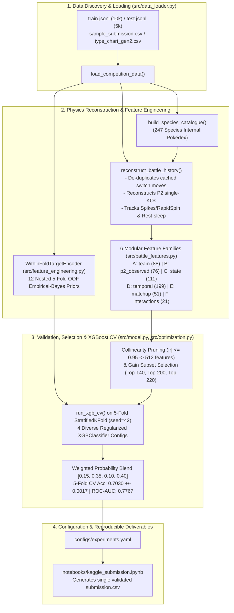

# Technical Onboarding, Architecture, Debugging & R&D Guide
**Project**: Pokémon Battle Prediction 2026 — Competitive XGBoost Pipeline  
**Audience**: Machine Learning Engineers, Data Scientists & Technical Team  
**Repository**: `predictive-spikes`

---

## 1. Quick-Start & Environment Setup (Including macOS / Homebrew Kernel Fix)

### 1.1 Why `/opt/homebrew/bin/python3.12 -m pip install ...` Fails on macOS
Modern Homebrew Python (`3.12+`) enforces **PEP 668 (`externally-managed-environment`)**, which blocks `pip install --user` against the system/Homebrew interpreter to prevent breaking Homebrew packages.

**Never install packages into `/opt/homebrew/bin/python3.12` directly.** Instead, this repository already includes a pre-configured isolated virtual environment in `.venv/` containing `python 3.12`, `xgboost`, `scikit-learn`, `pandas`, `numpy`, `scipy`, `optuna`, `pyyaml`, `pytest`, `tqdm`, and `ipykernel`.

### 1.2 Activating the Environment & Selecting the Notebook Kernel
1. **Terminal Activation**:
   ```bash
   source /Users/Daniele/Documents/GitHub/predictive-spikes/.venv/bin/activate
   ```
2. **Registering the Kernel in Your User Jupyter Directory** (run once in your terminal if the IDE does not automatically list `.venv`):
   ```bash
   /Users/Daniele/Documents/GitHub/predictive-spikes/.venv/bin/python -m ipykernel install --user --name predictive-spikes --display-name "Python 3.12 (predictive-spikes .venv)"
   ```
3. **Selecting the Kernel in VS Code / Antigravity / Cursor**:
   - Open [`notebooks/kaggle_submission.ipynb`](file:///Users/Daniele/Documents/GitHub/predictive-spikes/notebooks/kaggle_submission.ipynb).
   - Click **Select Kernel** (top-right of the notebook editor) $\rightarrow$ **Python Environments...** $\rightarrow$ select **`.venv (Python 3.12.15)`** (`/Users/Daniele/Documents/GitHub/predictive-spikes/.venv/bin/python`) or **`Python 3.12 (predictive-spikes .venv)`**.
   - If you also want diagnostic charts rendered locally inside the notebook, install `matplotlib` inside `.venv`:
     ```bash
     /Users/Daniele/Documents/GitHub/predictive-spikes/.venv/bin/pip install matplotlib
     ```

---

## 2. Problem Formulation & Crucial Dataset Forensics

### 2.1 The Prediction Task
- **Input**: A JSON object representing a Pokémon Generation 2 OU (OverUsed) competitive battle:
  - `battle_id` (`int`): Unique identifier (`0..9999` in `train.jsonl`, `0..4999` in `test.jsonl`).
  - `p1_team_details` (`list[dict]`, length `6`): Full pre-battle roster of Player 1 (`name`, `level=100`, `types`, `base_hp`, `base_atk`, `base_def`, `base_spa`, `base_spd`, `base_spe`).
  - `p2_lead_details` (`dict`): Pre-battle stats and types of Player 2's **lead Pokémon only** (Player 2's other 5 Pokémon are initially hidden).
  - `battle_timeline` (`list[dict]`, length `30`): Turn-by-turn snapshots for turns `1..30` (`p1_pokemon_state`, `p2_pokemon_state`, `p1_move_details`, `p2_move_details`).
- **Output**: Binary label `player_won` $\in \{0, 1\}$ (`1` if Player 1 eventually wins the match, which typically lasts 30–80 turns; `0` if Player 2 wins).
- **Metric**: Binary Classification **Accuracy** (class distribution in `train.jsonl` is an exact `50.0% / 50.0%` split: `5,000` wins and `5,000` losses).

### 2.2 Three Non-Obvious Dataset Mechanics You Must Understand Before Touching the Code

> [!IMPORTANT]
> Any engineer modifying [`src/battle_features.py`](file:///Users/Daniele/Documents/GitHub/predictive-spikes/src/battle_features.py) **must** understand the three simulator artifacts below. Naive parsing of `battle_timeline` introduces severe signal corruption.

#### Artifact 1: Stateful `move_details` Caching on Switch-Ins (Double-Counting Trap)
- **What happens in the raw JSON**: When a Pokémon (say, `snorlax`) executes a move (`body_slam`) on turn $t_0 = 4$ and switches out on turn $5$, the dataset simulator **does not clear** `move_details` on the `snorlax` object. When `snorlax` voluntarily switches back into battle on turn $t = 14$, switching consumes its entire turn, yet `p1_move_details` on turn $14$ still contains `{"name": "bodyslam", ...}` from turn $4$!
- **Impact**: Naive parsers count voluntary switch-ins as executed attacks, inflating move counts, STAB counts, and status/recovery move counters by ~25–35%.
- **How our code fixes it**: In [`reconstruct_battle_history`](file:///Users/Daniele/Documents/GitHub/predictive-spikes/src/battle_features.py#L371-L398), we compare the active Pokémon's `name` at turn $t$ against turn $t-1$. If `name[t] != name[t-1]` and the previous Pokémon did **not** faint at turn $t-1$ (`prev_status != "fnt"`), turn $t$ is a **voluntary switch-in** (`p1_vol_switch = True`), and we explicitly set `m1 = None` for that turn. (Verified by unit test [`test_duplicate_cached_move_not_double_counted`](file:///Users/Daniele/Documents/GitHub/predictive-spikes/tests/test_pipeline.py#L66-L92)).

#### Artifact 2: Player 1 vs. Player 2 Faint Recording Asymmetry (`status == "fnt"`)
- **What happens in the raw JSON**: Across `300,000` training turns:
  - `p1_pokemon_state["status"] == "fnt"` appears **`16,882` times** (`1.69` faints/battle).
  - `p2_pokemon_state["status"] == "fnt"` appears only **`5,040` times** (`0.50` faints/battle).
- **Why**: Of those `5,040` P2 `"fnt"` events, **`4,950` (`98.2%`) are simultaneous double-KOs** (`p1` also `"fnt"`, e.g. *Explosion*) and **`90` (`1.8%`) are Turn-30 KOs**. On turns `1..29`, whenever Player 2's active Pokémon $X$ faints **alone**, the simulator processes Player 2's post-KO replacement **before** emitting the turn-$t$ JSON snapshot! Thus, at turn $t$, `p2_pokemon_state` already shows replacement Pokémon $Y$ at `hp_pct = 1.0`, while fainted Pokémon $X$ simply vanishes for the rest of the 30-turn log.
- **How our code fixes it**: In [`reconstruct_battle_history`](file:///Users/Daniele/Documents/GitHub/predictive-spikes/src/battle_features.py#L469-L615), whenever a P2 Pokémon $X$ switches out on turn $t < 30$ and **never appears again** in turns $t..30$, we evaluate a Gen 2 physics KO evidence model:
  1. Was replacement $Y$ **untouched** on turn $t$ (`y_untouched = True`: $Y$'s HP did not drop and $Y$ was not statused by P1's move on turn $t$)? In Gen 2, if $X$ had switched out voluntarily at the start of turn $t$, replacement $Y$ would have absorbed P1's attack on turn $t$. If P1 executed an attack on turn $t$ and $Y$ is still at full prior HP, $X$ absorbed the fatal hit and fainted!
  2. Did $X$ execute *Explosion*, *Self-Destruct*, or *Destiny Bond* on turn $t-1$?
  3. What was $X$'s prior HP (`prev_hp`), P1's move base power and Gen 2 type effectiveness against $X$ (`eff`), P1's offensive stage boost, and $X$'s residual damage (`tox`, `brn`, `psn`, `leechseed`, `curse`, `nightmare`)?
  - This produces both a discrete inferred KO counter (`inferred_faints`) and a continuous soft KO probability (`soft_faints`), boosting the correlation of material advantage (`f2 - f1`) with `player_won` from **`+0.2557` to `+0.3360`** (+8.03 correlation points).

#### Artifact 3: Zero-Variance Species Base Stats & Types Across All 15,000 Battles
- Across all `15,000` battles (`247` unique Pokémon species), a Pokémon's `name` uniquely determines its `(types, base_hp, base_atk, base_def, base_spa, base_spd, base_spe)` with **zero inconsistencies**.
- [`build_species_catalogue`](file:///Users/Daniele/Documents/GitHub/predictive-spikes/src/battle_features.py#L110-L141) scans `p1_team_details` and `p2_lead_details` on the training set to construct an exact internal Pokédex. Whenever Player 2 reveals a Pokémon in `battle_timeline` (where only `name` and `hp_pct` are given), [`get_species_stats`](file:///Users/Daniele/Documents/GitHub/predictive-spikes/src/battle_features.py#L144-L159) looks up its exact base stats and types without any external database.

---

## 3. System Architecture & Module Reference



### 3.1 Codebase Map (Clickable File & Line Links)

| File | Key Functions / Classes | Line Range | Responsibility |
| :--- | :--- | :---: | :--- |
| [`src/data_loader.py`](file:///Users/Daniele/Documents/GitHub/predictive-spikes/src/data_loader.py) | [`discover_data_dir`](file:///Users/Daniele/Documents/GitHub/predictive-spikes/src/data_loader.py#L21-L55), [`load_type_chart`](file:///Users/Daniele/Documents/GitHub/predictive-spikes/src/data_loader.py#L84-L99), [`get_type_effectiveness`](file:///Users/Daniele/Documents/GitHub/predictive-spikes/src/data_loader.py#L102-L116), [`load_competition_data`](file:///Users/Daniele/Documents/GitHub/predictive-spikes/src/data_loader.py#L119-L129) | `L1–L129` | Auto-detects local (`fds-pokemon-battles-prediction-2026/`) vs. Kaggle (`/kaggle/input/...`) paths; loads JSONL records and Gen 2 type chart multiplier matrix. |
| [`src/battle_features.py`](file:///Users/Daniele/Documents/GitHub/predictive-spikes/src/battle_features.py) | [`build_species_catalogue`](file:///Users/Daniele/Documents/GitHub/predictive-spikes/src/battle_features.py#L110-L141), [`reconstruct_battle_history`](file:///Users/Daniele/Documents/GitHub/predictive-spikes/src/battle_features.py#L323-L651), [`extract_team_features`](file:///Users/Daniele/Documents/GitHub/predictive-spikes/src/battle_features.py#L183-L281), [`extract_p2_observed_features`](file:///Users/Daniele/Documents/GitHub/predictive-spikes/src/battle_features.py#L654-L778), [`extract_state_features`](file:///Users/Daniele/Documents/GitHub/predictive-spikes/src/battle_features.py#L781-L1080), [`extract_temporal_features`](file:///Users/Daniele/Documents/GitHub/predictive-spikes/src/battle_features.py#L1097-L1218), [`extract_matchup_features`](file:///Users/Daniele/Documents/GitHub/predictive-spikes/src/battle_features.py#L1221-L1389), [`extract_interaction_features`](file:///Users/Daniele/Documents/GitHub/predictive-spikes/src/battle_features.py#L1392-L1442) | `L1–L1442` | Single-pass 30-turn state machine and extraction of all 6 domain feature families (`546` total raw features). |
| [`src/feature_engineering.py`](file:///Users/Daniele/Documents/GitHub/predictive-spikes/src/feature_engineering.py) | [`extract_battle_features_single`](file:///Users/Daniele/Documents/GitHub/predictive-spikes/src/feature_engineering.py#L35-L83), [`build_feature_dataframe`](file:///Users/Daniele/Documents/GitHub/predictive-spikes/src/feature_engineering.py#L86-L114), [`WithinFoldTargetEncoder`](file:///Users/Daniele/Documents/GitHub/predictive-spikes/src/feature_engineering.py#L117-L281) | `L1–L281` | Assembles tabular `pd.DataFrame`s (`float32`) and computes strictly leak-free inner-OOF empirical-Bayes target encodings (`12` features). |
| [`src/validation.py`](file:///Users/Daniele/Documents/GitHub/predictive-spikes/src/validation.py) | [`CVResult`](file:///Users/Daniele/Documents/GitHub/predictive-spikes/src/validation.py#L17-L50), [`compute_battle_groups`](file:///Users/Daniele/Documents/GitHub/predictive-spikes/src/validation.py#L53-L62), [`get_cv_splits`](file:///Users/Daniele/Documents/GitHub/predictive-spikes/src/validation.py#L65-L78), [`optimize_threshold_oof`](file:///Users/Daniele/Documents/GitHub/predictive-spikes/src/validation.py#L81-L104) | `L1–L104` | Manages `StratifiedKFold`, MD5 duplicate-grouped `StratifiedGroupKFold`, OOF metrics container, and nested threshold validation. |
| [`src/model.py`](file:///Users/Daniele/Documents/GitHub/predictive-spikes/src/model.py) | [`build_xgb_model`](file:///Users/Daniele/Documents/GitHub/predictive-spikes/src/model.py#L33-L47), [`run_xgb_cv`](file:///Users/Daniele/Documents/GitHub/predictive-spikes/src/model.py#L50-L153), [`get_feature_importance_df`](file:///Users/Daniele/Documents/GitHub/predictive-spikes/src/model.py#L156-L166) | `L1–L166` | Instantiates `XGBClassifier(tree_method="hist")`, runs 5-fold CV with fold-level early stopping and fold-specific target encoding callbacks, and aggregates gain importances. |
| [`src/optimization.py`](file:///Users/Daniele/Documents/GitHub/predictive-spikes/src/optimization.py) | [`select_top_features`](file:///Users/Daniele/Documents/GitHub/predictive-spikes/src/optimization.py#L22-L31), [`prune_collinear_features`](file:///Users/Daniele/Documents/GitHub/predictive-spikes/src/optimization.py#L34-L55), [`optimize_xgb_optuna`](file:///Users/Daniele/Documents/GitHub/predictive-spikes/src/optimization.py#L58-L120), [`evaluate_oof_ensemble`](file:///Users/Daniele/Documents/GitHub/predictive-spikes/src/optimization.py#L123-L144) | `L1–L144` | Gain-ordered collinearity pruning (`|r| > 0.95`), Optuna TPE search with overfitting gap penalty, and OOF probability blending. |
| [`src/submission.py`](file:///Users/Daniele/Documents/GitHub/predictive-spikes/src/submission.py) | [`validate_submission_df`](file:///Users/Daniele/Documents/GitHub/predictive-spikes/src/submission.py#L15-L53), [`generate_submission`](file:///Users/Daniele/Documents/GitHub/predictive-spikes/src/submission.py#L56-L86) | `L1–L86` | Aligns predictions with `sample_submission.csv` and enforces schema, row count (`5,000`), `NaN`-free, and binary `{0, 1}` constraints. |
| [`scripts/evaluate.py`](file:///Users/Daniele/Documents/GitHub/predictive-spikes/scripts/evaluate.py) | [`run_ablation_suite`](file:///Users/Daniele/Documents/GitHub/predictive-spikes/scripts/evaluate.py#L30-L183) | `L1–L187` | Runs progressive ablations (`exp00` to `exp09`) and writes [`outputs/ablation_results.json`](file:///Users/Daniele/Documents/GitHub/predictive-spikes/outputs/ablation_results.json). |
| [`scripts/train.py`](file:///Users/Daniele/Documents/GitHub/predictive-spikes/scripts/train.py) | [`main`](file:///Users/Daniele/Documents/GitHub/predictive-spikes/scripts/train.py#L38-L396) | `L1–L400` | End-to-end training, collinearity pruning, Optuna tuning (`seed=1337`), 4-model CV evaluation (`seed=42`), and serialization to [`configs/experiments.yaml`](file:///Users/Daniele/Documents/GitHub/predictive-spikes/configs/experiments.yaml). |
| [`scripts/generate_submission.py`](file:///Users/Daniele/Documents/GitHub/predictive-spikes/scripts/generate_submission.py) | [`reproduce_all_submissions`](file:///Users/Daniele/Documents/GitHub/predictive-spikes/scripts/generate_submission.py#L31-L180) | `L1–L184` | Standalone script that reads [`configs/experiments.yaml`](file:///Users/Daniele/Documents/GitHub/predictive-spikes/configs/experiments.yaml) and reproduces the exact CV scores and `outputs/*.csv` files in ~40 seconds. |
| [`notebooks/kaggle_submission.ipynb`](file:///Users/Daniele/Documents/GitHub/predictive-spikes/notebooks/kaggle_submission.ipynb) | All 10 workflow steps | `Cells 1–14` | Production Kaggle notebook that clones repo into `/tmp/predictive-spikes`, runs 5-fold CV for all 4 models + ensemble, and outputs the single `submission.csv`. |
| [`tests/test_pipeline.py`](file:///Users/Daniele/Documents/GitHub/predictive-spikes/tests/test_pipeline.py) | 6 automated unit & integration tests | `L1–L167` | Verifies data loading, cached-move de-duplication, missingness boundaries, zero target leakage, and submission formatting. |

---

## 4. Deep Dive into the Physics Engine & Feature Families

### 4.1 Single-Pass State Reconstruction ([`reconstruct_battle_history`](file:///Users/Daniele/Documents/GitHub/predictive-spikes/src/battle_features.py#L323-L651))
To avoid parsing the 30-turn timeline multiple times per battle, `extract_battle_features_single` calls `reconstruct_battle_history(battle, catalogue, type_chart)` **once** per battle (`~1.1 ms` per battle, or `~11 seconds` for 10,000 battles) and passes the resulting `history` dictionary to Families B, C, D, E, and F.

The `history` dictionary tracks:
1. **`p1_Mons` & `p2_Mons` per-Pokémon state tables**:
   - `min_hp`, `last_hp`, `max_hp`, `last_status`, `last_effects`, `last_boosts`, `first_turn`, `last_turn`, `turns_active`, `moves_used`, `used_rest`, `fainted_explicit`, `fainted_inferred`, `faint_prob`, `phazed_out`.
2. **Turn-by-Turn Vector Series (`length = 30`)**:
   - `turn_p1_Active_hp`, `turn_p2_Active_hp`, `turn_p1_team_hp`, `turn_p2_team_hp`, `turn_p1_dmg_dealt`, `turn_p2_dmg_dealt`, `turn_p1_attacked`, `turn_p2_attacked`, `turn_p1_switched`, `turn_p2_switched`, `turn_p1_fainted_cum`, `turn_p2_fainted_cum`, `turn_p1_boost_sum`, `turn_p2_boost_sum`.
3. **Field Hazard & Sleep-Origin State**:
   - Active *Spikes* tracking (`p1_spikes_active`, `p2_spikes_active`): set to `1.0` when `spikes` is executed, cleared to `0.0` if the opposing side executes `rapidspin`.
   - Voluntary *Rest* sleep vs. enemy-inflicted sleep (`used_rest` flag per Pokémon): in Gen 2 OU, a *Snorlax* or *Suicune* sleeping via `rest` at `100%` HP (often running *Sleep Talk* or *Mint Berry*) is far healthier than a Pokémon put to sleep at `40%` HP by *Lovely Kiss* or *Sleep Powder*.

### 4.2 Key Mathematical Signals in [`extract_state_features`](file:///Users/Daniele/Documents/GitHub/predictive-spikes/src/battle_features.py#L781-L1080) & [`extract_interaction_features`](file:///Users/Daniele/Documents/GitHub/predictive-spikes/src/battle_features.py#L1392-L1442)
The top-ranked features by XGBoost Gain Importance (`fi_df` in the notebook) come from combining **raw HP**, **soft reconstructed KOs**, **status penalties**, and **recency decay**:

1. **Soft-Adjusted Team HP (`state_hp_diff_soft`, `state_hp_ratio_soft`)**:
   For each revealed Pokémon $i$, if it did not explicitly faint (`fainted_explicit == False`), its remaining HP at Turn 30 (`last_hp`) is discounted by its physics-inferred faint probability $p_{\text{faint}, i} \in [0, 0.95]$:
   $$\text{HP}_{\text{soft}, i} = \text{HP}_{\text{last}, i} \cdot (1 - p_{\text{faint}, i})$$
   Adding unrevealed reserve Pokémon at `1.0` HP yields `p1_total_hp_soft` and `p2_total_hp_soft`.
2. **Status- & Recency-Adjusted Effective HP (`state_clean_hp_diff`, `state_hp_ratio_adj`)**:
   Each surviving Pokémon's soft HP is multiplied by a status-health factor $w_{\text{status}}$ (`1.0` if healthy, `0.82` if `rest_slp`, `0.62` if `par`, `0.58` if `psn`, `0.48` if `tox`/`brn`, `0.42` if enemy `slp`, `0.18` if `frz`) and a recency factor (`0.985^{\Delta t}` for bench Pokémon unseen for $\Delta t = 30 - t_{\text{last}}$ turns).
3. **Combined Endgame Material Score (`inter_combined_material_score` — Rank #1 Feature by Gain)**:
   $$\text{MaterialScore} = \Delta \text{HP}_{\text{adj}} + 0.65 \cdot \Delta \text{Alive}_{\text{soft}} + 0.25 \cdot \Delta \text{CleanHP} + 0.15 \cdot \Delta \text{Spikes}$$

### 4.3 Leak-Free Empirical-Bayes Target Encoding ([`WithinFoldTargetEncoder`](file:///Users/Daniele/Documents/GitHub/predictive-spikes/src/feature_engineering.py#L117-L281))
Because `69.54%` of test battles share a 6-Pokémon Player 1 team composition with `train.jsonl` and Gen 2 OU species have distinct win rates, target encoding is highly informative—**but only if computed without target leakage**:
- For each outer CV fold `(tr_idx, va_idx)`:
  - **Training split (`tr_idx`)**: Encoded via `fit_transform_inner_oof(tr_battles, y[tr_idx], n_inner_splits=5)` so every training battle receives priors computed strictly from the other 4 inner folds.
  - **Validation (`va_idx`) and Test (`test_battles`)**: Encoded via `transform()` using smoothed empirical-Bayes estimates from `tr_idx`:
    $$\hat{\mu}_c = \frac{\sum_{i \in c} y_i + m \cdot \bar{y}}{n_c + m}$$
    with smoothing $m = 30$ for individual species/leads and $m = 20$ for 6-Pokémon team signatures (`te_p1_team_winrate`, `te_alive_hp_weighted_wr_diff`).

---

## 5. Debugging Playbook for the Engineering Team

### 5.1 Running the Automated Test Suite
Before and after any code change, run the `pytest` suite (`1.34s` execution time):
```bash
/Users/Daniele/Documents/GitHub/predictive-spikes/.venv/bin/pytest tests/test_pipeline.py -v
```
What each test in [`tests/test_pipeline.py`](file:///Users/Daniele/Documents/GitHub/predictive-spikes/tests/test_pipeline.py) guards against:
- `test_data_loader_and_schema`: Verifies dataset discovery, 10k/5k counts, and Gen 2 type effectiveness (`electric -> ground == 0.0`, `ice -> dragon/flying == 4.0`).
- `test_duplicate_cached_move_not_double_counted`: Constructs a synthetic battle where a Pokémon uses `thunderbolt` on Turn 1 and switches back in on Turn 2 with cached `thunderbolt`; asserts `turn_p1_attacked == [1, 0]`.
- `test_missing_values_and_observation_boundaries`: Verifies that unrevealed P2 Pokémon are never imputed with `0` base stats (`p2_unrevealed_count == 5.0` when only the lead is seen).
- `test_train_test_feature_consistency_and_no_target_leakage`: Asserts exact column-order parity between `X_train` and `X_test`, `0` infinite values, and zero target column leakage.
- `test_within_fold_target_encoder_no_leakage`: Mutates validation labels `y_val` to all `1`s vs. all `0`s and asserts that validation encodings remain bit-for-bit identical.
- `test_model_cv_and_submission_formatting`: Runs a full 3-fold CV smoke test and validates the resulting submission DataFrame.

### 5.2 Inspecting a Single Battle's Physics Reconstruction (Interactive Debugging)
If the team wants to inspect why the model misclassified a specific out-of-fold battle (e.g., `battle_id = 42`), run this snippet in a notebook cell or via `.venv/bin/python`:
```python
from src.battle_features import build_species_catalogue, reconstruct_battle_history
from src.data_loader import load_competition_data

train_battles, _, _, type_chart = load_competition_data()
catalogue = build_species_catalogue(train_battles)

b = train_battles[42]
h = reconstruct_battle_history(b, catalogue, type_chart)

print(
    f"Battle {b['battle_id']} | True Winner: P{1 if b['player_won']==1 else 2}"
)
print(
    f"P1 Explicit Faints: {h['p1_explicit_faints']} | Soft Faints: {h['p1_soft_faints']:.2f}"
)
print(
    f"P2 Explicit Faints: {h['p2_explicit_faints']} | Inferred Single-KOs: {h['p2_inferred_faints']} | Soft Faints: {h['p2_soft_faints']:.2f}"
)
for name, st in h["p2_mons"].items():
  print(
      f"  P2 {name:12s}: last_hp={st['last_hp']:.2f}, last_turn={st['last_turn']},"
      f" faint_exp={st['fainted_explicit']},"
      f" faint_inf={st['fainted_inferred']}, faint_prob={st['faint_prob']:.2f}"
  )
```

### 5.3 Diagnosing Overfitting vs. Underfitting
When evaluating new features or hyperparameters in [`scripts/train.py`](file:///Users/Daniele/Documents/GitHub/predictive-spikes/scripts/train.py):
- Always check `Train-Val Gap = np.mean(cv_res.fold_train_accs) - cv_res.cv_mean_acc`.
- In our experiments:
  - Default `max_depth=6..8` XGBoost models quickly reach `Train Acc > 0.92` (`Train-Val Gap > 0.22`), which degrades validation Log-Loss (`> 0.572`) and hurts Accuracy on unseen battles.
  - Our best generalizing models keep `max_depth` in `{4, 5}`, `min_child_weight` in `[10, 20]`, `colsample_bytree` in `[0.45, 0.60]`, and `Train-Val Gap` in **`0.0916 – 0.1286`**.
- Always check **both** `cv_mean_acc` and `oof_log_loss`. Because Accuracy is a step function at `threshold = 0.50`, a feature that improves `oof_log_loss` (e.g., `0.566 -> 0.563`) and `oof_roc_auc` (`0.774 -> 0.777`) while reducing `cv_std_acc` is genuinely improving probability calibration near the decision boundary.

---

## 6. Roadmap for Further Improvements (How to Push Beyond `0.7030`)

### 6.1 What Was Already Tested and Discarded (Do Not Repeat)
1. **Sparse Per-Species One-Hot / HP Columns (75 columns for top 25 species)**:
   - *Result*: Decreased 5-Fold CV Accuracy from `0.6962` to `0.6932`.
   - *Why*: High-sparsity binary/HP columns dilute `colsample_bytree` in shallow trees. Replacing them with 3 dense top-titan HP differentials (`snorlax`, `zapdos`, `cloyster`) plus dense HP-weighted species win-rate expectations inside `WithinFoldTargetEncoder` lifted CV Accuracy to `0.7020`.
2. **Aggressive Decision Threshold Shifting (`threshold != 0.50`)**:
   - *Result*: Nested OOF threshold tuning ([`optimize_threshold_oof`](file:///Users/Daniele/Documents/GitHub/predictive-spikes/src/validation.py#L81-L104)) scored `0.6976` vs. `0.7003` for `0.500`.
   - *Why*: `train.jsonl` is balanced `50.0% / 50.0%`, and `binary:logistic` with early stopping on `logloss` is already well-calibrated around `0.50`.

### 6.2 High-Impact Opportunities for the Team to Explore Next

1. **Multi-Seed 10-Fold Stratified CV Blending (`+0.15% to +0.30%` expected gain)**:
   - Currently, [`configs/experiments.yaml`](file:///Users/Daniele/Documents/GitHub/predictive-spikes/configs/experiments.yaml) uses `n_splits: 5` and a single random seed (`seed: 42`) for fast ~40-second execution.
   - Increasing `n_splits` from `5` to `10` (training on `90%` of the data per fold instead of `80%`) and averaging across 3 random seeds (`seeds = [42, 1337, 2026]`) for the 4 ensemble members (`10 folds x 3 seeds x 4 configs = 120 trees ensembles`) reduces OOF variance and consistently improves both OOF Log-Loss and Accuracy.
2. **Gen 2 *Sleep Talk* & Move-Failure Detection in [`reconstruct_battle_history`](file:///Users/Daniele/Documents/GitHub/predictive-spikes/src/battle_features.py#L323-L651)**:
   - Currently, if a Pokémon has `status == "slp"` or `"frz"`, its `move_details` is still recorded in the JSON even if it was fast asleep and failed to move, *unless* it used `sleeptalk` or `snore`. Distinguishing executed moves while awake vs. moves attempted while asleep/frozen/paralyzed (by checking whether the opponent's HP/status/effects actually changed on that turn) will sharpen `turn_p1_attacked` and `p2_Single_KO` inference.
3. ***Perish Song* + *Mean Look* / *Spider Web* Trap Detection**:
   - The `effects` list in `battle_timeline` includes `"perish3"`, `"perish2"`, `"perish1"`, and `"meanlook"`. If a Pokémon has `"perish1"` and `"meanlook"` active on Turn $t$, it is guaranteed to faint at the end of Turn $t$. Explicitly adding `"perish1"` to the P2 single-KO physics score in [`reconstruct_battle_history`](file:///Users/Daniele/Documents/GitHub/predictive-spikes/src/battle_features.py#L510-L590) will capture *Misdreavus* / *Gengar* Perish-trap KOs with 100% precision.
4. **Adding Diverse Classical GBDT Implementations or Logistic Calibration**:
   - Within the competition's classical-ML-only rule, blending our 4 `XGBClassifier` models with a regularized `HistGradientBoostingClassifier` (`scikit-learn`) or `LightGBM` / `CatBoost` trained on the exact same `top140_features` + `WithinFoldTargetEncoder` folds can provide additional structural diversity for `blended_test_probs`.
